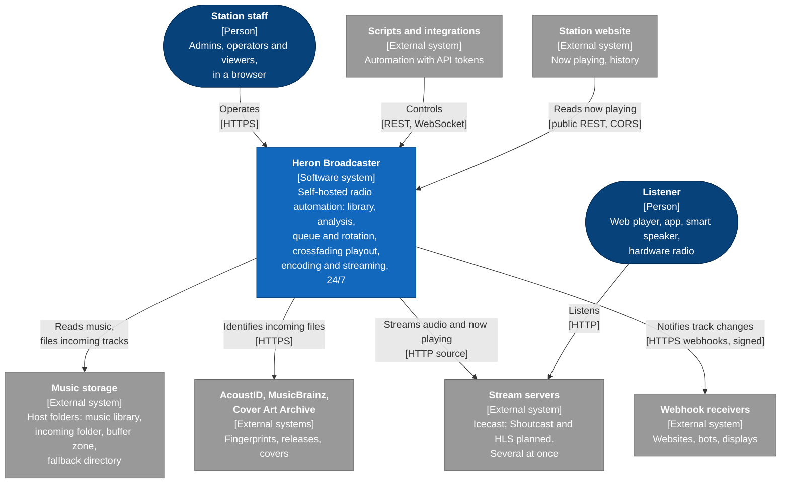
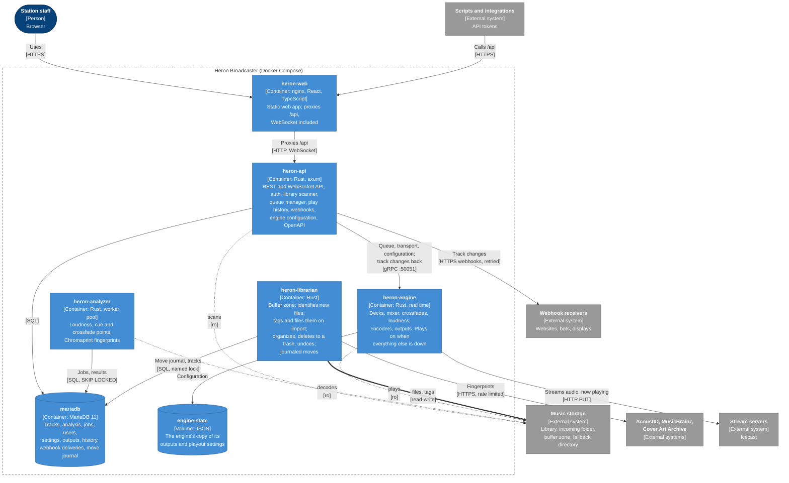

# Architecture

## C4 model

The first two levels of the [C4 model](https://c4model.com/): Heron in its environment, then the containers it runs as (one Docker Compose service each). Elements marked *planned* come with later milestones.

### Level 1: system context



### Level 2: containers



Notation: dark blue for people, blue for Heron and its containers, grey for external systems, dashed for planned ones. In the containers view, dotted arrows are read-only access to the music storage; only `heron-librarian` writes to it (thick arrow).

The engine never connects to the database ([Locked decisions](decisions.md)): it gets everything it plays, and its configuration, from `heron-api` over gRPC.

## Processes

```
                ┌───────────────┐        WebSocket / REST         ┌──────────────┐
                │   heron-web   │ ◄─────────────────────────────► │              │
                │ React (static)│                                 │  heron-api   │──► Webhooks
                └───────────────┘                                 │  axum        │
                                                                  │  scanner     │
 Music library ─────────────────────────────────────────────────► │  queue mgr   │
   (volume)  │ ▲                                                  └──┬───────┬───┘
             │ │ files, tags   ┌─────────────────┐                   │       │
             │ └───────────────│ heron-librarian │ ◄──── incoming    │       │
             │                 │ identify, file, │       folder      │       │
             │                 │ trash           │ ◄──── buffer zone ◄ uploads
             │                 └─────────────────┘                   │       │
             │                                                       │       │ gRPC (tonic)
             │         ┌────────────────┐   analysis jobs / results  │       ▼
             └───────► │ heron-analyzer │ ◄────────► MariaDB ◄───────┘ ┌──────────────┐
                       │ worker pool    │                              │ heron-engine │──► encoders ──► outputs
                       └────────────────┘     fallback directory ───►  │ decks, mixer │     MP3      ──► Icecast A, B
                                                                       │ DSP,encoders │     AAC-LC   ──► Icecast C, HLS
                                                                       └──────────────┘     ffmpeg*  ──► Shoutcast D
                                                                                            (* user-provided binary)
```

| Service | Role |
|---|---|
| **heron-engine** | Real-time playout: decks, mixer, crossfades, DSP, encoders and output sinks (several outputs at once, see [Encoders and outputs](outputs.md)). Reads the music library and the fallback directory, both mounted read-only. Exposes a gRPC control interface (`heron-engine ctl` is its command-line client). Holds the upcoming tracks in memory and keeps its outputs and settings on disk. **Must keep playing if every other service is down.** See [Audio engine](audio-engine.md). |
| **heron-api** | HTTP + WebSocket server: auth (local users), library, categories, artists, clocks and rotation (with `heron-rotation`), queue manager, selection log, play history, webhooks, the library scanner, and uploads, written into the buffer zone (never into the library). Feeds the engine over gRPC and pushes it its playout settings and outputs. See [API and control plane](api.md). |
| **heron-analyzer** | Analysis worker pool, as its own modular service. Reads files from the music library volume, runs `heron-analysis` and stores results in MariaDB. Can be scaled independently (several replicas) and restarted without affecting the API or the air. Uses CPUs − 1 workers by default. |
| **heron-librarian** | Library management, as its own service: moves files dropped into the incoming folder into the buffer zone, identifies the files waiting there (Chromaprint, AcoustID, MusicBrainz, Cover Art Archive) and flags duplicates, then tags them and files them into the library when they are imported; deletes tracks through a trash and purges it; reorganizes the library on request and undoes changes; looks up MusicBrainz relationships between artists on request. **The only service with write access to the library**, so `heron-api` (which faces the network) keeps a read-only mount. Every move is journaled in MariaDB and finished or rolled back after a crash. See [Library management](library.md). |
| **heron-web** | Static React build. |
| **mariadb** | Database. Used by `heron-api`, `heron-analyzer` and `heron-librarian`, never by `heron-engine`. |

### Priorities

The air comes first when the machine is short of CPU, disk or memory (a large import on a Raspberry Pi):

| | heron-engine | heron-api, mariadb, heron-web | heron-analyzer | heron-librarian |
|---|---|---|---|---|
| CPU weight between containers (`cpu_shares`) | 8192 | 1024 | 256 | 256 |
| Killed when memory runs out (`oom_score_adj`) | last (−500) | 0 | first (500) | 300 |
| Niceness inside the container | 0; its fallback analysis thread 19 | 0 | 10 (`HERON_NICE`) | 10 (`HERON_NICE`) |
| I/O priority | normal | normal | lowest best-effort | lowest best-effort |

- Under cgroup v2, the kernel first shares the CPU between containers by their weight, then between the threads of a container by their niceness: lowering a service's niceness alone does not make it yield to another container, hence `cpu_shares` in `docker-compose.yml`. Weights only matter when the CPU is busy. Every service sets one: some Docker versions map `cpu_shares: 1024` below the weight of a container without it.
- The analyzer and the librarian lower themselves before their runtime starts, so every thread inherits it (`heron_service::priority`). Lowering needs no privilege; a niceness set higher by the operator is kept. The I/O priority only matters with an I/O scheduler that uses it (BFQ).
- No service raises its priority: real-time scheduling of the engine's audio thread would need `CAP_SYS_NICE`, and is not needed while `heron_engine_clock_max_late_seconds` stays under the 50 ms lead (see [Monitoring](monitoring.md)).

Change these with a `docker-compose.override.yml`, or `HERON_NICE` (0 leaves the niceness as is).

### Scanner and analyzer split

Built in [M1](roadmap/m1-import-analysis.md); details in [Import and analysis](analysis.md):

- The **scanner** stays in `heron-api`: it walks and watches the library, reads tags, upserts `tracks` and enqueues analysis jobs when a file is new, changed, or analyzed with an older `analysis_version`.
- **`heron-analyzer`** claims jobs from a MariaDB-backed queue (`analysis_jobs`, using `SELECT … FOR UPDATE SKIP LOCKED`), analyzes the file and writes `track_analysis`.
- A database-backed queue adds no new infrastructure (no message broker) and lets any number of analyzer replicas share the work. If a broker is ever needed, the job interface in `heron-analysis` keeps the swap local.

### Scanner and librarian

Built in [M1b](roadmap/m1b-library-management.md). The librarian records every file it moves or re-tags in `tracks` (new path, new stamp) in the same step, so the read-only scanner finds those files unchanged. They share a MariaDB named lock (`GET_LOCK`): a scan never runs in the middle of a move. Shared code (audio file detection, content hash, tags, folder layout, the lock) lives in `heron-library`.

## Repository layout

```
heron-broadcaster/
├── crates/
│   ├── core/       heron-core       shared types: track, cue points, fade curves, settings
│   ├── proto/      heron-proto      gRPC definitions between api and engine
│   ├── analysis/   heron-analysis   loudness, silence, cue and fade point detection, Chromaprint fingerprints
│   ├── library/    heron-library    library files shared by scanner and librarian: tags, content hash, layout, lock
│   ├── dsp/        heron-dsp        resampling; later EQ, compressor, expander, limiter, crossovers, AGC chain
│   ├── outputs/    heron-outputs    encoders, OutputSink trait + Icecast (later Shoutcast, HLS, file, pipe)
│   ├── rotation/   heron-rotation   pure rotation: separation, restrictions, relaxation, clocks, selection, simulation
│   ├── service/    heron-service    process plumbing: logging, Sentry, /healthz, /metrics, remote write, clock sync, shutdown, DB connect
│   ├── engine/     heron-engine     binary: decks, mixer, pacing clock, decoding, preloading, player, fallback, gRPC server, ctl
│   ├── api/        heron-api        binary: axum, auth, queue manager, history, OpenAPI, webhooks, scanner
│   ├── analyzer/   heron-analyzer   binary: analysis worker pool, job queue consumer
│   └── librarian/  heron-librarian  binary: incoming folder, buffer zone, identification, layout, journaled moves, organize, trash, undo
├── web/                             React + Vite + TypeScript
├── migrations/                      sqlx migrations
├── docker/                          Dockerfiles
├── monitoring/                      Grafana dashboard and Prometheus alert rules to import (docs/monitoring.md)
├── scripts/                         test library, streaming, soak and chaos tests
├── docker-compose.yml
├── LICENSE                          AGPL-3.0
└── README.md
```

## Suggested libraries

| Need | Crate / library |
|---|---|
| Decoding | `symphonia` |
| Resampling | `rubato` |
| Loudness (EBU R128) | `ebur128` |
| Tags | `lofty` |
| Fingerprints (Chromaprint) | `rusty-chromaprint` (MIT) |
| AcoustID, MusicBrainz, Cover Art Archive | `reqwest` (rustls) |
| Renames that never replace | `rustix` (`renameat2(RENAME_NOREPLACE)`, `renamex_np(RENAME_EXCL)`) |
| Lock-free ring buffers | `rtrb` |
| Filters | `biquad` or hand-written biquads |
| MP3 / Opus / Vorbis encoding | LAME (`mp3lame-encoder`, built from source and linked statically), libopus, libvorbis bindings |
| AAC-LC encoding | FFmpeg's native `aac` encoder via libavcodec (no `--enable-nonfree`, e.g. `ffmpeg-next` bindings) |
| HLS segmenting | Hand-written segmenter, or libavformat's `hls` muxer |
| HTTP / WebSocket | `axum`, `tokio` |
| OpenAPI | `utoipa`, `utoipa-axum` (generated from the handlers); `openapi-typescript` and `openapi-fetch` on the web side |
| Passwords | `argon2` (Argon2id) |
| gRPC | `tonic`, `prost`; `protox` compiles the `.proto` files in Rust, so builds need no `protoc` |
| Database | `sqlx` (MySQL/MariaDB) |
| Logging / metrics | `tracing`, `metrics` + Prometheus exporter |
| Station time, time zones | `jiff` (time zone database bundled: the images have none) |
| Name matching | `unicode-normalization` |
| Optional monitor output | `cpal` |

These are suggestions: replace one if there is a good reason, and say why. Codec choices are constrained by the license: Heron never ships or links fdk-aac, and any FFmpeg libraries it links must be built without `--enable-nonfree` (see [Locked decisions](decisions.md)).
